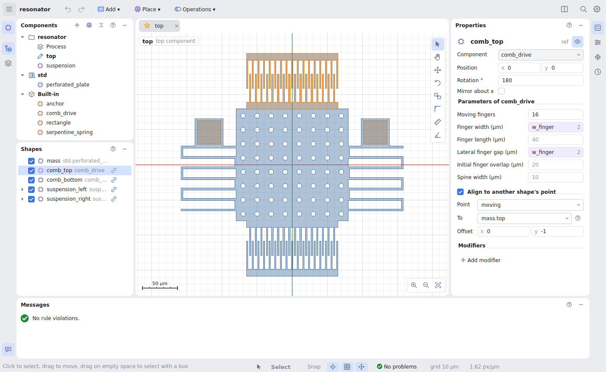

# mems-sketch

Parametric MEMS layout design. A design is built from components whose
values are parameters and expressions, so changing a pitch or a gap redraws
everything that depends on it. The tool checks design rules and exports GDS,
OASIS and DXF. It is for sketching a design: process steps after it (etch
compensation, mask preparation) and simulation are out of scope.



- **Parametric all the way down:** every value can be an expression; parts
  stay attached through alignment points when values change.
- **Non-destructive operations:** subtract, offset, fillet, arrays, mirrors
  and per-corner rounding stay editable.
- **Projects are text:** a folder of small YAML files, made for git, with a
  History panel that shows what changed, in words and on the canvas.
- **Works with other tools:** GDS and OASIS import; projects and geometry as
  JSON, XML or MATLAB `.mat`; a command line and a Python API.

## Install and run

**Download the app** from the
[releases page](https://github.com/TorosBenjamin/mems-sketch/releases): nothing
else needs to be installed.

- **Windows:** `MEMS-Sketch-<version>-Windows-x64-Setup.exe` installs it for
  you (no administrator rights needed); the `-Windows-x64-Portable.zip` runs
  from any folder. Windows may warn about an unknown publisher (the app is not signed
  yet): *More info* → *Run anyway*.
- **macOS** (Apple silicon): open the `.dmg` and drag *MEMS Sketch* to
  Applications. The first time, right-click it and choose *Open* (it is not
  signed yet).
- **Linux:** make the `.AppImage` executable (`chmod +x`) and run it.
- **Python package:** `mems-sketch-<version>-python-wheels.zip` holds the
  wheels for every system; unzip it and
  `pip install "mems-sketch[gui]" --find-links <the folder>`.

From the source, with Python 3.11 or newer:

```bash
pip install -e ".[gui]"                        # add ,matlab for .mat files
mems-sketch examples/resonator/resonator.msketch    # the editor
mems-sketch-cli check examples/resonator       # the same design, from the command line
```

AI assistants can open, edit, build, look at and check designs through an MCP
server (`pip install -e ".[gui,mcp]"`, then `mems-sketch-cli mcp`): see
[AI assistants](docs/user/ai-assistants.md).

## Documentation

- **[User guide](docs/user/README.md)**: the editor, components and
  parameters, shapes and operations, files and formats, history.
- **[Developer guide](docs/developer/README.md)**: architecture, the Python
  API, file formats, and how to extend the tool.
- **[Contributing](CONTRIBUTING.md)**: branches, pull requests and checks.
