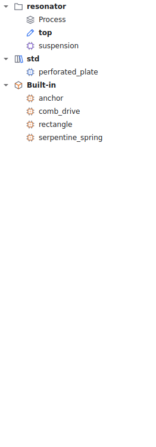
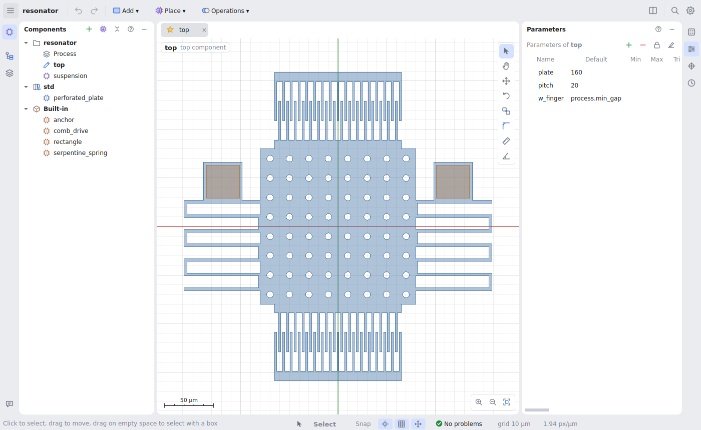
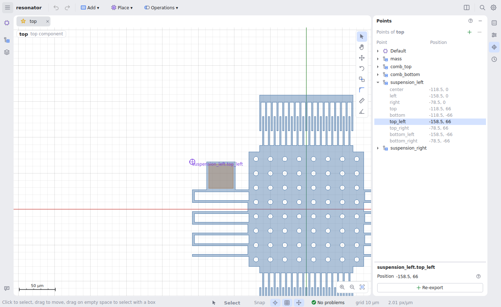
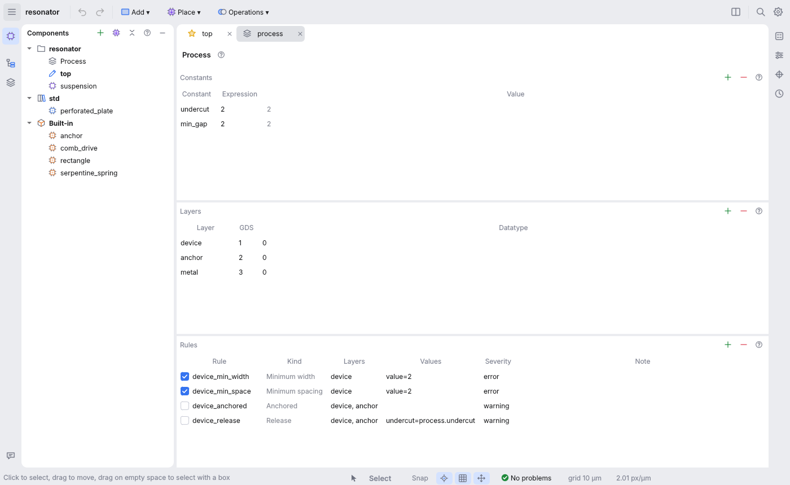

# Components, parameters and points

## Everything is a component

A component has **parameters** and a **shape tree** (what it is made of, see
[shapes](shapes-and-operations.md)). The design itself is the **top**
component: its parameters play the role of global variables, so any project
can be placed inside another one.



The **Components** panel lists every component once:

- **the project's own** (purple; a star marks the top one), with **Process**
  first;
- **each library's** (blue), read-only, in its **categories** (Springs,
  Electrodes, …); the **bundled** libraries are among them (see
  [Libraries](#libraries));
- **Imported** layouts, if any (see [files](files.md#importing-layouts)).

Two libraries are bundled: `mems` has anchors, springs (folded flexures,
crab legs, serpentines, …), electrodes (comb drives, gap-closing plates),
proof masses and two whole devices, a resonator and an accelerometer, and the
example processes such as `mems.surface`; `std` has the parts any layout
uses, whatever the device: alignment marks, Verniers, test structures, bond
pads and a die frame. Their galleries, [mems](library-mems.md) and
[std](library-std.md), show every component with its parameters. They are
ordinary components: they draw on the level they are placed on (an anchor's
opening on that level's anchor layer), their limits are shown like any other,
and **Copy into the project** makes an editable copy. A plain rectangle is the
`rect` shape.

Double-click opens a component in a tab. Drag one onto the canvas, or use
**Place** (Shift+A, see [the window](the-window.md#placing-components)), to put
it into the component you are editing. With nothing selected, Properties shows
the open component's **Description**, shown wherever it is placed from. Right-click for the
rest: rename (every reference follows), duplicate, delete, set as top, new
private component, make shared or private, copy a library component into the
project, add or remove a library, make the project a library. The **+**
button adds a component or a library.

### Shared and private components

A component is **shared** or **private** to another one, like a nested class:
`comb/finger` is `finger`, made for `comb` and placed only inside it. It is
listed under its owner. This says what belongs to what, not where things are
used; hover a component to see what it places and where it is placed. **Make
component** (Ctrl+K) on a selection makes a private component of the one you
are editing.

## Parameters



The **Parameters** panel lists the current component's parameters: default,
min, max, a trial value and the resolved value.

- A **default** is a number or an expression over other parameters
  (`margin` defaulting to `(pitch - hole) / 2`) and process constants
  (`process.min_gap`).
- **Min**, **max** and *integer* limit what can be passed in. A limit can be
  an expression over the other parameters (an anchor's enclosure with max
  `size / 2`). Start it with `>` or `<` to exclude the limit itself
  (`> 0`: more than zero). The component's card shows each limit evaluated.
- A parameter is **public** (whoever places the component can set it) or
  **internal** (the lock button): used only inside, typically a derived value.
  Where the component is placed, internal parameters are not offered.
- A **trial** value shows the component with another value without changing
  the design: it is not saved or undone and only affects that component's own
  tab. It also works on library components, so you can try a
  spring with more turns before using it.
- Values passed to a placed component are evaluated where it is placed;
  parameters left out take their defaults.

**Make a parameter from a value:** in Properties, the parameter button beside
any number field (on hover) makes a new parameter with that value as default
and uses it.

## Points

Instead of calculating positions, place things relative to each other's
**points**:

- **Every shape** has the points of the box around it: `center`, `left`,
  `right`, `top`, `bottom`, `top_left`, `top_right`, `bottom_left`,
  `bottom_right`.
- **A component can declare points** for whoever places it: where a spring
  ends, where a comb's moving spine is. The `mems` ones have some
  (`mems.serpentine_spring` has `start` and `end`; `mems.comb_drive` has
  `moving` and `fixed`).
- **In expressions**, a point's coordinates are `<shape>.<point>.x` and `.y`,
  e.g. `base.right.x - 5`.



The **Points** panel lists them as objects: first the component's own points
(editable), then **Default** (the box around the whole component), then the
points of each named shape. Hover a point to see it on the canvas; click it to
pan there and edit it in the form below. **Re-export** turns a shape's point
into a point of this component, measured from the original, so it follows
it: that is how a component passes on a point of a part inside it. Renaming a
point updates everything that uses it.

Points are drawn on the canvas only while you work with them: with the Points
panel open, or while aligning (**View → Overlays → Always show points** to
see them all the time).

## Libraries

A library is a folder of components (any project folder works), added from
the Components panel's **+** or listed in `project.yaml`:

```yaml
libraries:
  mems: bundled@2        # a bundled one, and the version the project was saved with
  fab: ../fab-library    # a folder of your own
```

Its components are placed as `fab.plate`. **Bundled** libraries ship with
mems-sketch and every project has them without listing them: `mems` (MEMS
components and example processes) and `std` (generic layout parts). A project lists them anyway, with
their version, so that opening it with a release whose library changed says
so. Libraries are read-only:
to change a library component for one project, right-click it and **Copy into
the project**; the copy is editable and keeps using the library's other
components.

A project without a top component is itself a library: just components, meant
to be placed elsewhere (**File → New library**, or **Make the project a
library** in the Components panel).

**Categories:** a library shows its components in categories, the folders
they are in (`components/springs/serpentine_spring/`). The folder is only where
a component is shown: its name, and every reference to it, stay the same when
it moves to another folder. A folder may have a `category.yaml` with a
`title`, a `description` and an `order`. Components may also have `tags`,
words that Search Everywhere finds them by.

Projects saved before the `mems` library existed placed `anchor`,
`comb_drive` and `serpentine_spring` by their bare names: opening one
changes those to `mems.anchor` and so on, and says so once.

## The process

**Process** (the first item under the project in Components, or **View →
Process**) is a tab with the process the project uses at the top, then a card
each for the process constants, available in every expression as
`process.<name>`, the layers with their GDS layer and datatype, and the design
rules.



### The layer stack and component levels

The layers' **Level** column places them in the **layer stack**: a number
makes a layer a level (1 at the bottom), and `poly1.anchor` makes it level
poly1's *anchor* layer. Any other role name works too (`via`, `dimple`).

Every component is on a level, and its shapes are drawn relative to it:

- a shape's layer `level` is the component's level (a new shape without a
  layer is there too); `level+1` and `level-1` are the levels above and
  below; `level.anchor` is the level's anchor layer;
- a layer by name (`metal`) stays that layer wherever the component is.

A component is on the level its placement chooses (*Level* in its
properties: `poly2`, or `level+1` relative to the component placing it).
Without one, it is on its own default level (**Level** in its right-click
menu in Components), and without that, on the level of the component that
places it. So one comb drive can be placed on poly1 here and on poly2 there,
and its anchors follow. A level that runs off the bottom or top of the stack,
or a role the level does not have, is an error on that placement.
**Top components on level** under the layers chooses where a component
without a default is in its own tab.

**Grid** and **Curve tolerance** are the fab's: the design rules are checked on
the design rounded onto that grid, with curves split within that tolerance,
which is what the fab will check; layout exports start from them too. The
design itself stays exact. They belong to the process: a project using a
library's process takes them from it.

### Design rules

Each rule is a **kind** of check on some layers, with values. Values are
numbers or expressions over the process constants, so a rule can follow the
process: `process.undercut`. A rule kind with one value shows and takes just
the value (`2`); one with several, `name=value` separated by commas.

| Kind | Layers | Checks |
|---|---|---|
| Minimum width, spacing | one | nothing narrower or closer than `value` |
| Maximum width | one | nothing wider than `value` |
| Minimum area, hole area | one | no piece (hole) smaller than `value` µm² |
| Number of pieces | one | the layer is `pieces` separate pieces |
| Enclosure | outer, inner | the inner layer is inside the outer, by at least `value` |
| Separation | first, second | the layers are at least `value` apart and do not overlap |
| Inside, not overlapping | two | one layer inside the other; the two never overlap |
| Anchored | layer, anchor | every piece touches an anchor, so nothing floats away at release |
| Release | layer, anchor | away from anchors no part is wider than twice the `undercut` (or the etch cannot free it: add release holes), and anchors are wider than that (or the undercut frees them too) |

A new project starts with minimum width and spacing on the device layer and
the **anchored** and **release** rules (as warnings, with a `process.undercut`
constant). Change any value, add rules with **+** (pick the kind), and untick a
rule to turn it off: it stays listed, as off, so it never quietly disappears.
**Severity** is `error` or `warning`. Select a rule and its details fold out
under it: its **Note**, shown with its violations (e.g. why the rule exists),
and where it comes from.

Rules are checked on the final geometry after every change; **Messages**
lists the violations and the canvas boxes them in red. More kinds can be
installed as plugins (`mems-sketch-cli rules` lists them).

### Processes from a library

A process (layers, layer stack, constants and rules) can be shared like
components: a library can hold processes, typically one per fab process, kept
by whoever looks after it. The bundled `mems` library has three example
processes; [Processes and process libraries](process-libraries.md) shows them
and how to write your own. Choose the one the project uses under **Process**
at the top of the tab: the project's own, or `library.process`.

On a library's process:

- **Change a constant or a rule** for this project by editing it like any
  other; the rule is marked with a dot, its details say *(changed)*, and it can
  say why under **Reason**.
  Untick a rule to turn it off. **Reset** takes the process's rule again.
- **Add rules** of your own; they are marked *(added)*.
- The **layers and the layer stack** belong to the fab and cannot change
  here: use a process of the project's own for that.

When the library's process changes, the project follows it everywhere except
where it changed it. The changes are kept in `project.yaml`, each with its
reason.

### Waivers

Sometimes a violation is meant: a test structure narrower than the minimum
width, say. Right-click it in **Messages** and choose **Waive…** to accept it,
with a reason. It stays listed, greyed and marked *Waived* with the reason,
but no longer counts as a problem, is not boxed on the canvas, and does not
fail `check`. The waiver is saved with the component.

A waiver covers that violation as it is: when the geometry around it changes,
the waiver lapses and the violation shows again, marked *waiver lapsed*. A
waiver that no longer matches any violation is listed as a warning to remove
(right-click, **Remove the waiver**).
