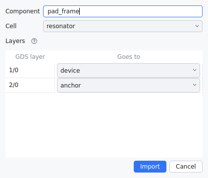

# Files, import and export

## The project folder

A project is a folder of small text files, meant to live in git:

```
my_project/
  project.yaml        the manifest: name, top component, libraries, the process
                      used, and where its processes and components are
  processes/main/
    process.yaml      process constants, layers (GDS numbers), layer stack, rules
  components/
    top/component.yaml        one folder per component; the design is the top one
    comb/component.yaml
    comb/finger/component.yaml   a component private to comb
  imports/
    padframe.gds      a copy of each imported layout
```

A library is a project folder too, usually without a top component. It can
hold processes as well as components, so a fab's process (its layers, stack,
constants and rules) is shared the way components are.

Files are always written the same way: values equal to their default are left
out, keys keep a fixed order, and unchanged files are not rewritten: a file you
edited by hand keeps its comments and layout until something in it changes.
Changing one value changes one line. Saving removes only the files of
components, processes and imports the project itself had; other files in the
folder are left alone. See `examples/resonator`, and the bundled library it uses,
`src/mems_sketch/libraries/mems`.

**File** (in **☰**): New (Ctrl+N), New library, Open (Ctrl+O), Save (Ctrl+S)
and Save as. Open also takes a one-file project or a legacy `.mems` design;
those open as a copy, which **Save as** stores as a folder. When a project is
already open, Open asks, once you have chosen the file, whether to open it in
this window or in a new one; only opening it here asks about unsaved changes.

## Exporting

**File → Export…** (Ctrl+E) writes the component in the current tab, as
drawn (with its trial values):

| Format | For |
|---|---|
| GDSII (`.gds`), OASIS (`.oas`), DXF (`.dxf`) | Mask and layout tools; layers get their GDS numbers from the process |
| Geometry as JSON (`.json`), XML (`.xml`), MATLAB (`.mat`) | Scripts: the polygons, plus the component's points and parameter values |

A layout file (GDSII, OASIS, DXF) is written on its **grid**, with curves
split into straight segments within its **curve tolerance**; both start as the
process's (see [Design rules](components.md#design-rules)). The design itself
stays exact: it is rounded once, when the file is written. If rounding onto a
coarse grid changes the shape of the design (a gap narrower than the grid
closes, a thin neck comes apart, a small hole fills up), the export says what
changed and where, with the area before and after.

A geometry file holds, per layer, the polygons as rows of `x y` points in µm,
each with its holes; then the points and parameters. In MATLAB:

```matlab
s = load('comb.mat');
s.layers.device.polygons{1}.hull    % N×2, µm; holes in .holes
s.points.tip                        % .x, .y
s.parameters.pitch
```

`.mat` files need `pip install 'mems-sketch[matlab]'`. They are written in
the format MATLAB's `load` reads by default; files saved with `-v7.3` cannot
be read.

## Importing layouts

**File → Import…** (Ctrl+I) makes a layout into a read-only component:

- **one cell of a GDS file**: a foundry pad frame, alignment marks, an
  earlier design (its sub-cells are flattened). OASIS and DXF files are
  written but not read: save the cell as GDS in the tool that made it;
- **a geometry file** (JSON, XML, `.mat`) written by a script or exported
  above. Only `format: mems-sketch-geometry/1` and `layers.<name>.polygons`
  are needed; a polygon is an N×2 matrix, or `{hull, holes}`.



The dialog asks for the component's name, the cell, and where each layer
goes: the project layer with the same GDS numbers, a new layer, or left out.
Layers of a geometry file keep their names.

The component is listed under **Imported** in Components. It has no parameters
but is placed, arrayed, aligned (to its `center`, `top_left`, …) and rounded
like any other. The project keeps a copy of the file in `imports/`, so it does
not depend on the original. Right-click the component for **Re-import…** (a
newer version: every placement follows) or **Remove import**.

## One-file projects

For other tools, a whole project fits in one file: **JSON**, **XML**, **MATLAB
`.mat`** or **YAML**. It holds what the folder holds, the imported layouts
included. Convert with the command line (below); a folder converted to a file
and back gives the same files.

## The command line

The same design, without the editor, e.g. in scripts, CI or from MATLAB with
`system(...)`:

```bash
mems-sketch-cli new     my_project [--library] [--process mems.surface]
mems-sketch-cli new-process my_fab [--from mems.soi]         # a process library to fill in
mems-sketch-cli info    my_project [--component NAME] [--json]  # components, parameters, layers
mems-sketch-cli check   my_project [--component NAME] [--set pitch=15] [--json] [--strict]
mems-sketch-cli rules                                        # the rule kinds and their values
mems-sketch-cli export  my_project out.gds [--set pitch=15]  # also .oas .dxf .json .xml .mat
                [-O grid_um=0.005]                         # a setting of the format
mems-sketch-cli formats                                      # the formats and their settings
mems-sketch-cli convert my_project design.json               # and back; .xml .mat .yaml
mems-sketch-cli convert old_design.mems my_project           # the earlier format
mems-sketch-cli mcp     [my_project]                         # for AI assistants (MCP)
```

- `check` exits with status 1 when a rule with severity *error* is violated
  (with `--strict`, a *warning* too), so it can gate CI; errors exit with
  status 2. Waived violations are listed but never fail it. Each violation
  says what was measured and the shapes it is on; `--json` gives them as
  `measured_um` and `shapes` (the MCP `check` too).
- `--set` takes numbers or expressions (which may use the component's other
  parameters, as a default can: `--set pitch=plate/16`) and can be repeated:
  convenient for parameter sweeps.
- `new` starts a project on a process of its own (device, anchor and metal
  layers); `--process` picks a bundled library's instead (`mems.surface`,
  `mems.polysilicon`, `mems.soi`). `new-process` makes a library holding one
  process, a copy of `--from` (or `empty`), to edit into your fab's.
- `info` shows the process (its grid and curve tolerance), layers, rules,
  constants and components; `--component` one component's parameters with
  their limits, points and ports (a library's too: `mems.anchor`); `--json`
  the same as JSON.
- `export` writes into missing folders, and warns of a cell name some layout
  tools refuse (GDSII names are up to 32 letters, digits, `_`, `?` and `$`).
- `convert` does not overwrite a folder that already holds a project, or a
  one-file project that exists.
- `mcp` serves the design tools to an AI assistant over stdin/stdout; the
  assistant's app starts it (see [AI assistants](ai-assistants.md)).
- `-O NAME=VALUE` (or `--option`) sets one of the format's settings and can
  be repeated; `formats` lists them. GDSII, OASIS and DXF take `grid_um`, the
  file's grid (a whole multiple of 1 nm), `chord_um`, the curve tolerance
  (both default to the process's; `grid` and `chord` work too, as the
  process calls them), and `top_cell`, the top cell's name. What
  rounding onto the grid changed in the shape of the design is printed after
  the file is written. **File → Export…** asks for the same settings and
  remembers, per project and format, the ones you changed from the
  project's own (so another project starts from its process's grid again).
