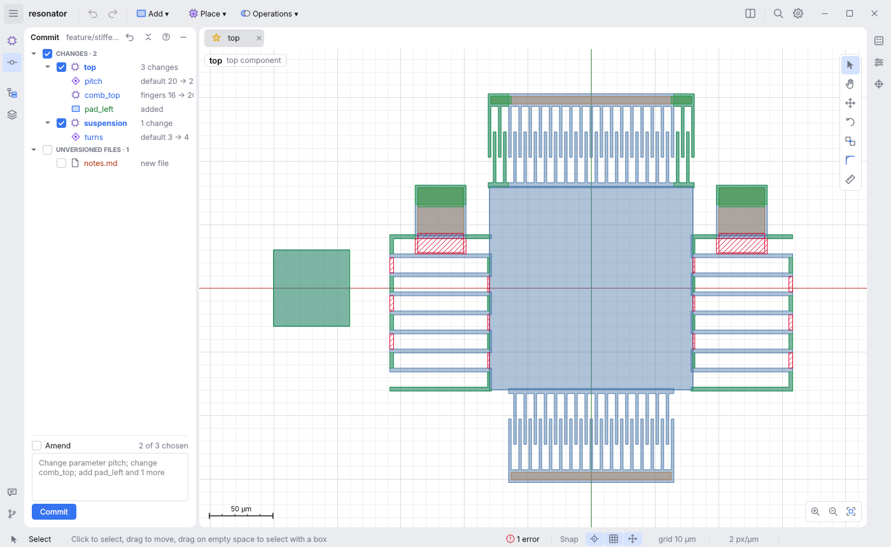
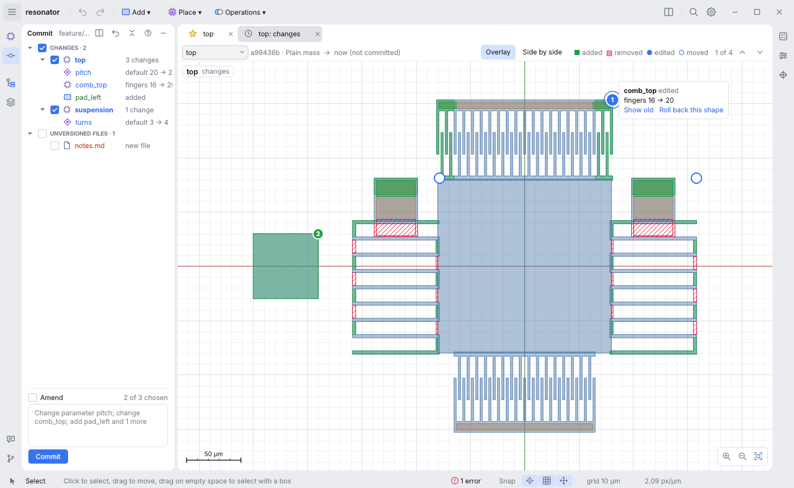
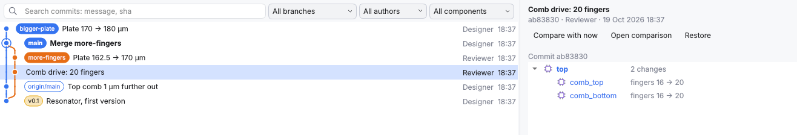

# Git: committing and history

For a project saved in a git repository, the **Commit** panel (on the left
edge) lists what changed since the last commit and commits it, and the
**Git** panel (along the bottom) draws the commits of every branch as a
graph, shows what each changed, and brings back earlier versions.

## The Commit panel

**Ctrl+K** (as in JetBrains IDEs; **File → Commit…**) opens it with its message
ready to type. The changes since the last commit, saved or not, are listed by
what holds them: one row per component (with its private ones), and rows for the
project, its process and its imports.

- **A row unfolds into each change**: `pitch  default 20 → 24 µm`,
  `comb_top  fingers 16 → 20`, `pad_left  added`. A change to several fields
  of one thing (a parameter's default, minimum and maximum) unfolds again,
  one line per field. Click a change to open its component and select the
  shape.
- **Names are coloured** by what happened: green added, blue changed, grey
  removed. Other files in the project's folder that git sees changed are
  listed with them; files git does not track yet are in **Unversioned files**,
  orange, with *Add to git* and *Ignore* on the right-click menu.
- **On the canvas**, material added is tinted green and material removed is
  hatched red, in the component you are editing (with default parameters). A
  one-number change that moves half the device shows at a glance.
- The panel follows your edits, saving, and the app coming back to the front
  (in case you used git meanwhile). Its header shows the branch, and how many
  commits it is ahead (↑) or behind (↓) the one it tracks.

### Committing

**Check what goes into the commit.** A component is the unit: git commits
files, and each component is a file of its own. Files git does not track yet
are left out unless you check them.

Type a message and press **Commit**. A message is suggested from the checked
changes (`Change parameter pitch; add pad_left`); leave the box empty to use
it. **Amend** replaces the last commit with this one, starting from its
message.

- The project is saved first, and **only the checked files are committed**.
  The project file lists the components, so it goes with a component added,
  removed or moved to another category. Files you staged elsewhere in the
  repository stay staged and are named under the box.
- Git needs to know who you are, once: `git config --global user.name "Your
  Name"` and `git config --global user.email you@example.com`. The panel says
  so if it is missing.

### Rolling back

Right-click a row and **Roll back** to bring that component (or the project,
process or imports) back as it is in the last commit. It is an ordinary edit:
Undo takes it back. A component added since the last commit is removed. A
changed file outside the design is put back after you confirm, and that
cannot be undone.

## The comparison tab

Double-click a change in the Commit panel (or press the split button in its
header) to open the comparison: a tab in the editor with two versions of the
component on the canvas. Double-click a commit in the Git panel for what it
changed.

- **Overlay** shows the new version with the material added tinted and the
  material removed hatched; **Side by side** shows the earlier version on the
  left, the two zooming and panning together. Choose another changed
  component from the list on the left of the tab's bar.
- **Each edited shape has a numbered mark**; a shape that only moved or
  changed size because of another change (a parameter it follows, a shape it
  is aligned to) has a ring. Hover a mark for what changed (`fingers 16 →
  20`, `moved y +4 µm`).
- **The arrows step through every mark**, zooming to each: the changes too
  small to see at a glance are found as well.
- For the uncommitted changes, **Roll back this shape** on a mark's card brings
  that one shape back as in the last commit (an added one is removed): an
  ordinary edit, which Undo takes back. **Show old** goes side by side, at that
  shape.
- While it compares with the design now, the tab follows your edits.

## The Git panel

The commits that changed the project, drawn as a graph, newest first: each
branch has a line and a colour of its own, and the commits carry their branch
and tag labels (a filled label is a local branch, an outlined one a remote
branch, a yellow one a tag; the branch checked out is in bold, its commit
ringed).

- **The branch filter** lists the commits on the branch checked out (the
  default), on another branch, or on **All branches**.
- **Search** the messages (or type the start of a sha), or keep **one
  author's** commits. The graph's lines are hidden while you do, as the
  commits left out would break them.
- **The component filter** keeps the commits that changed one component (and
  its private ones).
- **Choose a commit** for its message, sha, author, date and labels on the
  right, with what it changed by component; the canvas shows the material it
  added and removed in the component you are editing. Click a change to go to
  it, double-click it (or the commit) to compare in a tab.
- **Compare with now** shows everything changed since that commit.
  **Restore** brings back the project as it was, or the component you are
  editing: an ordinary edit, which Undo takes back, and nothing in git
  changes. The Commit panel then shows what the restore changed; commit it to
  keep it. The same are on a commit's right-click menu.

## Starting a repository

A saved project that is not in a repository gets **Initialize git here**.
Checking out, merging, push and pull stay with your usual git tools for now.
