# The `mems` library

MEMS components and example processes. Every project has it: its components are placed as
`mems.<component>`, read-only (**Copy into the project** makes an editable
copy). Each is shown at its defaults.

*This page is generated from the components by `python docs/gallery.py`.*

## Anchors

Pads that hold structures to the substrate.

### `mems.anchor`

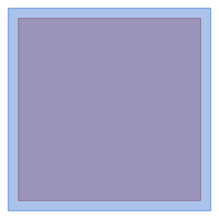

Square pad on the component's level, centred on the origin, fixed to the substrate by an opening on the level's anchor layer (`level.anchor`) inset by the enclosure. Keep the enclosure within the process's undercut and its enclosure rule (2 µm suits the example processes), and the opening wider than twice the undercut, or the etch frees it.

| Parameter | Default | Limits | |
|---|---|---|---|
| `size` | `40` | > 0 | Pad edge length (µm) |
| `enclosure` | `2` | ≥ 0, < size / 2 | Overlap of the pad around the anchor (µm) |

*Tags: anchor, pad, support*

## Springs

Flexures that suspend masses.

### `mems.serpentine_spring`

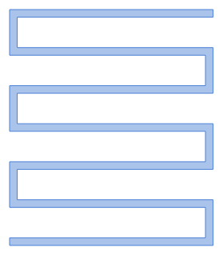

Meandering beam spring running along +y from the origin: beams `span` long across, `pitch` apart, joined by bends at alternate ends. Long beams in a small space make it soft along y and sideways; it has no anchor, so place one at either end. Its stiffness has no short closed form (see Fedder's serpentine model): try the turns and the span with trial values. Points: start and end, the middle of the outer edge of the first and the last beam.

| Parameter | Default | Limits | |
|---|---|---|---|
| `turns` | `3` | ≥ 1, whole | Number of meanders: each adds two beams |
| `beam_width` | `3` | > 0 | Beam width (µm) |
| `span` | `80` | > 0 | Meander span, x (µm) |
| `pitch` | `15` | > beam_width | Meander pitch, y (µm) |

*Tags: spring, serpentine, meander, flexure*

### `mems.clamped_beam`

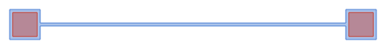

Clamped-clamped beam: a straight beam along x between two anchors, centred on the origin. Pushed sideways (y) at its middle it is a spring of stiffness 16 E t w³ / L³ (`stiffness`, for the Young's modulus and thickness set here); it also stiffens as it bends far, which a folded flexure avoids. Its center is the beam's middle.

| Parameter | Default | Limits | |
|---|---|---|---|
| `length` | `200` | > 0 | Beam length between the anchors, L (µm) |
| `beam_width` | `2` | > 0 | Beam width, w (µm) |
| `anchor_size` | `20` | > 4 | Anchor pad edge length (µm); more than twice the anchor's 2 µm enclosure |
| `youngs_modulus` | `160` | > 0 | Young's modulus of the structural layer, E (GPa; 160 for polysilicon) |
| `thickness` | `2` | > 0 | Thickness of the structural layer, t (µm) |
| `stiffness` | `16 * youngs_modulus * 1000 * thickness * beam_width ** 3 / length ** 3` |  | *(derived)* Sideways stiffness at the middle (N/m) |

*Tags: spring, beam, fixed-fixed, bridge, flexure*

### `mems.guided_beam`

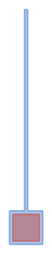

Guided beam: a beam along +y from an anchor at the origin, its free end meant to be held parallel (guided) by what it carries, so that it bends in an S. Sideways (x) it is a spring of stiffness E t w³ / L³ (`stiffness`). Point: tip, the middle of the free end, where the mass attaches.

| Parameter | Default | Limits | |
|---|---|---|---|
| `length` | `120` | > 0 | Beam length, L (µm) |
| `beam_width` | `2` | > 0 | Beam width, w (µm) |
| `anchor_size` | `20` | > 4 | Anchor pad edge length (µm); more than twice the anchor's 2 µm enclosure |
| `youngs_modulus` | `160` | > 0 | Young's modulus of the structural layer, E (GPa; 160 for polysilicon) |
| `thickness` | `2` | > 0 | Thickness of the structural layer, t (µm) |
| `stiffness` | `youngs_modulus * 1000 * thickness * beam_width ** 3 / length ** 3` |  | *(derived)* Sideways stiffness at the tip (N/m) |

*Tags: spring, beam, guided, flexure*

### `mems.u_spring`

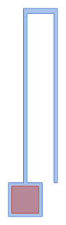

U-spring: two parallel beams along +y joined at the top, the left one on an anchor at the origin, the right one free at the bottom, where the mass attaches. Its two guided beams are in series: sideways (x) it is a spring of stiffness E t w³ / (2 L³) (`stiffness`), a quarter of a guided beam of the same length for half the space. Point: attach, the middle of the free leg's end.

| Parameter | Default | Limits | |
|---|---|---|---|
| `length` | `100` | > 0 | Beam length, L (µm) |
| `beam_width` | `2` | > 0 | Beam width, w (µm) |
| `spread` | `18` | > anchor_size / 2 + beam_width / 2 | Between the beams' centres; the free one clears the anchor pad (µm) |
| `truss` | `3` | > 0 | Width of the bar that joins them at the top (µm) |
| `anchor_size` | `20` | > 4 | Anchor pad edge length (µm); more than twice the anchor's 2 µm enclosure |
| `youngs_modulus` | `160` | > 0 | Young's modulus of the structural layer, E (GPa; 160 for polysilicon) |
| `thickness` | `2` | > 0 | Thickness of the structural layer, t (µm) |
| `top` | `anchor_size / 2 + length` |  | *(derived)* Where the beams meet the bar (µm) |
| `stiffness` | `youngs_modulus * 1000 * thickness * beam_width ** 3 / (2 * length ** 3)` |  | *(derived)* Sideways stiffness at the free end (N/m) |

*Tags: spring, u-spring, folded, flexure*

### `mems.folded_flexure`

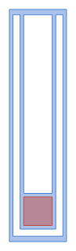

Folded flexure: two beams rise from an anchor at the origin to a truss, and two outer beams come back down from it, past the anchor, to a shuttle bar below, where the mass attaches. The truss takes up the beams' shortening, so it stays linear over large travel. Sideways (x) the inner and outer pairs are in series: 2 E t w³ / (L³ + Lo³) (`stiffness`), L the inner beams' length and Lo the outer ones'. Point: attach, the middle of the shuttle bar's bottom edge.

| Parameter | Default | Limits | |
|---|---|---|---|
| `length` | `100` | > 0 | Inner beam length, L (µm) |
| `beam_width` | `2` | > 0 | Beam width, w (µm) |
| `gap` | `4` | > 0 | Between neighbouring beams, and between the anchor and the shuttle bar (µm) |
| `truss` | `3` | > 0 | Width of the truss and of the shuttle bar (µm) |
| `anchor_size` | `20` | > max(4, 2 * beam_width) | Anchor pad edge length (µm); more than twice the anchor's 2 µm enclosure |
| `youngs_modulus` | `160` | > 0 | Young's modulus of the structural layer, E (GPa; 160 for polysilicon) |
| `thickness` | `2` | > 0 | Thickness of the structural layer, t (µm) |
| `inner_x` | `anchor_size / 2 - beam_width / 2` |  | *(derived)* Centre of the inner beams (µm) |
| `outer_x` | `inner_x + gap + beam_width` |  | *(derived)* Centre of the outer beams (µm) |
| `top` | `anchor_size / 2 + length` |  | *(derived)* Where the beams meet the truss (µm) |
| `bottom` | `-anchor_size / 2 - gap` |  | *(derived)* Where the outer beams meet the shuttle bar (µm) |
| `outer_length` | `top - bottom` |  | *(derived)* Outer beam length, Lo (µm) |
| `stiffness` | `2 * youngs_modulus * 1000 * thickness * beam_width ** 3 / (length ** 3 + outer_length ** 3)` |  | *(derived)* Sideways stiffness at the shuttle bar (N/m) |

*Tags: spring, folded flexure, folded beam, suspension, resonator, flexure*

### `mems.crab_leg`

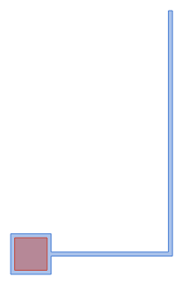

Crab-leg spring: a thigh along +x from an anchor at the origin, then a shin along +y to where the mass attaches. The thigh makes it softer along the shin's length than a plain beam, the shin sideways. Across the shin (x) its stiffness is E t w³ (4 Lt + Ls) / (Ls³ (Lt + Ls)) (`stiffness`, equal widths; Fedder's crab-leg model). Point: attach, the middle of the shin's end.

| Parameter | Default | Limits | |
|---|---|---|---|
| `thigh` | `60` | > 0 | Thigh length, Lt (µm) |
| `shin` | `120` | > 0 | Shin length, Ls (µm) |
| `beam_width` | `2` | > 0 | Beam width, w (µm) |
| `anchor_size` | `20` | > 4 | Anchor pad edge length (µm); more than twice the anchor's 2 µm enclosure |
| `youngs_modulus` | `160` | > 0 | Young's modulus of the structural layer, E (GPa; 160 for polysilicon) |
| `thickness` | `2` | > 0 | Thickness of the structural layer, t (µm) |
| `knee` | `anchor_size / 2 + thigh` |  | *(derived)* Where the thigh meets the shin (µm) |
| `stiffness` | `youngs_modulus * 1000 * thickness * beam_width ** 3 * (4 * thigh + shin) / (shin ** 3 * (thigh + shin))` |  | *(derived)* Stiffness across the shin, x (N/m) |

*Tags: spring, crab-leg, flexure*

## Masses

Proof masses and plates.

### `mems.perforated_plate`

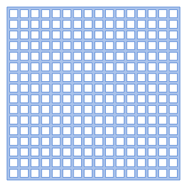

Square plate centred on the origin, with a grid of release holes (square, rounded or round) so that the etch frees it: the webs between holes, and the rim, are `web` wide. Where four webs meet, the nearest hole corner is 0.71 webs away (more with rounded holes): keep that under the process's undercut. The holes are centred, so the rim is between one web and one web plus a pitch wide.

| Parameter | Default | Limits | |
|---|---|---|---|
| `size` | `162.5` | ≥ 10 | Edge length (µm): a whole number of pitches plus a web gives a rim one web wide |
| `pitch` | `10` | ≥ web + 0.5 | Hole pitch (µm); at least a web and the smallest hole |
| `hole` | `pitch - web` | ≥ 0.5, < pitch | Hole size (µm); by default the pitch less a web |
| `corner_radius` | `0` | ≥ 0 | Corner radius of the holes (µm): 0 square, half the size round; rounder holes leave more between their corners |
| `web` | `2.5` | > 0 | *(derived)* Between neighbouring holes (µm) |
| `margin` | `pitch - hole` |  | *(derived)* From the plate's edge to the holes (µm) |

*Tags: mass, plate, proof mass, perforated, release holes*

### `mems.proof_mass`

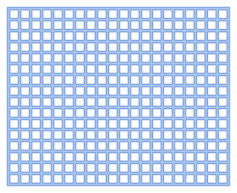

Rectangular proof mass centred on the origin, sized by its holes so that the rim and the webs are all `web` wide and the etch frees it everywhere. Holes keep clear of an attachment zone at the middle of each edge (`attach` wide, `attach_depth` deep): deepen them where a spring or a spine needs solid material to land on (a zone wider than twice the undercut stays stuck). Points: attach_top, attach_bottom, attach_left and attach_right, the middles of the edges.

| Parameter | Default | Limits | |
|---|---|---|---|
| `columns` | `20` | ≥ 1, whole | Holes across (x) |
| `rows` | `16` | ≥ 1, whole | Holes up (y) |
| `pitch` | `10` | > web | Hole pitch (µm) |
| `web` | `2.5` | > 0 | Between holes, and the rim (µm); where four webs meet the nearest hole is 0.71 webs away: keep that under the undercut |
| `attach` | `6` | ≥ 0 | Width of the attachment zones (µm) |
| `attach_depth` | `2.5` | ≥ 0 | Depth of the attachment zones (µm); a web deep, they keep the rim |
| `width` | `columns * pitch + web` |  | *(derived)* Mass width (µm) |
| `height` | `rows * pitch + web` |  | *(derived)* Mass height (µm) |

*Tags: mass, proof mass, perforated, release holes, accelerometer, resonator*

### `mems.frame_mass`

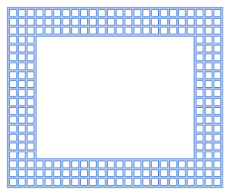

Rectangular frame mass centred on the origin: a perforated ring, its outer edge and its width whole numbers of hole pitches (plus a web), with an opening in the middle for an inner mass, anchors or electrodes. All webs and rims are `web` wide, so it releases. Points: the corners and edge middles of the box around it, as for any shape.

| Parameter | Default | Limits | |
|---|---|---|---|
| `columns` | `24` | ≥ 3, whole | Hole pitches across the outside (x) |
| `rows` | `20` | ≥ 3, whole | Hole pitches up the outside (y) |
| `frame` | `3` | ≥ 1, < min(columns, rows) / 2, whole | Holes across the frame's width |
| `pitch` | `10` | > web | Hole pitch (µm) |
| `web` | `2.5` | > 0 | Between holes, and the rims (µm) |
| `width` | `columns * pitch + web` |  | *(derived)* Outside width (µm) |
| `height` | `rows * pitch + web` |  | *(derived)* Outside height (µm) |
| `band` | `frame * pitch + web` |  | *(derived)* Frame width (µm) |

*Tags: mass, frame, perforated, release holes, gyroscope, decoupling*

### `mems.dimple_array`

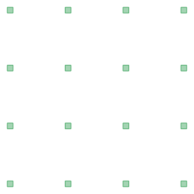

Dimples on the level's dimple layer (`level.dimple`), in a grid from the origin along +x and +y: placed under a mass, they make bumps that keep it from sticking to the substrate after release. Only for a level with a dimple layer (the polysilicon process's poly1).

| Parameter | Default | Limits | |
|---|---|---|---|
| `columns` | `4` | ≥ 1, whole | Dimples across (x) |
| `rows` | `4` | ≥ 1, whole | Dimples up (y) |
| `pitch` | `40` | > size | From one dimple to the next (µm) |
| `size` | `4` | > 0 | Dimple edge length (µm) |

*Tags: dimple, anti-stiction, mass*

## Electrodes

Comb drives and electrodes that move or sense.

### `mems.comb_drive`

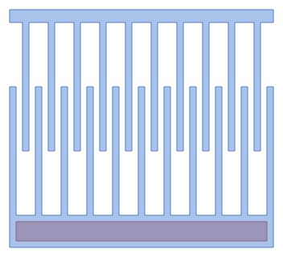

Interdigitated comb: a fixed comb (bottom spine) and a moving comb (top spine), centred on the finger overlap. A voltage pulls the moving comb in along -y with a force of about n ε₀ t V² / gap (n moving fingers, t the thickness), the same at any overlap. The fixed spine sits on an anchor along its length (`anchored`; 0 for none); the moving spine is narrow enough to release and attaches to what it moves. Points: moving and fixed, the middle of each spine's outer edge. Port: drive, the fixed comb's connection.

| Parameter | Default | Limits | |
|---|---|---|---|
| `fingers` | `10` | ≥ 1, whole | Moving fingers |
| `finger_width` | `2` | > 0 | Finger width (µm) |
| `finger_length` | `40` | > 0 | Finger length (µm) |
| `gap` | `2` | > 0 | Lateral finger gap (µm) |
| `overlap` | `20` | ≥ 0, < finger_length | Initial finger overlap: the travel towards the fixed comb is the rest of the finger length (µm) |
| `spine_width` | `10` | > 0 | Fixed spine width (µm) |
| `moving_spine_width` | `4` | > 0 | Moving spine width: narrow enough for the etch to release it (µm) |
| `anchored` | `1` | ≥ 0, ≤ 1, whole | 1: the fixed spine on an anchor along its length; 0: no anchor |
| `enclosure` | `2` | ≥ 0, < spine_width / 2 | Fixed spine around its anchor (µm) |
| `pitch` | `2 * (finger_width + gap)` |  | *(derived)* |
| `total` | `(fingers + 1) * finger_width + fingers * finger_width + 2 * fingers * gap` |  | *(derived)* Width of the spines (µm); the fixed comb has one finger more |
| `x_start` | `-total / 2` |  | *(derived)* |

| Port | At | Direction | Width | |
|---|---|---|---|---|
| `drive` | `fixed_spine.bottom` | `down` | `spine_width` | The fixed comb's connection, off the middle of its spine |

*Tags: electrode, comb drive, actuator, capacitive, resonator*

### `mems.comb_drive_with_stops`

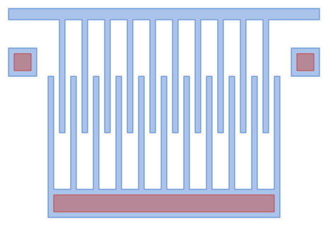

Comb drive (as `comb_drive`, anchored) with motion limiters: tabs at both ends of the moving spine stop on anchored posts after `travel` towards the fixed comb, before the fingers can reach the fixed spine or snap sideways. Points: moving and fixed, and the port drive, as on the comb drive.

| Parameter | Default | Limits | |
|---|---|---|---|
| `fingers` | `10` | ≥ 1, whole | Moving fingers |
| `finger_width` | `2` | > 0 | Finger width (µm) |
| `finger_length` | `40` | > 0 | Finger length (µm) |
| `gap` | `2` | > 0 | Lateral finger gap (µm) |
| `overlap` | `20` | ≥ 0, < finger_length | Initial finger overlap (µm) |
| `travel` | `10` | > 0, < finger_length - overlap | How far the moving comb can move towards the fixed one (µm) |
| `stop_size` | `10` | > 4 | Stop posts' anchor pads (µm) |
| `side_gap` | `4` | ≥ 2 | Between the comb and the stops (µm) |
| `moving_spine_width` | `4` | > 0 | *(derived)* |
| `total` | `(2 * fingers + 1) * finger_width + 2 * fingers * gap` |  | *(derived)* Width of the spines (µm) |
| `spine_bottom` | `-overlap / 2 + finger_length` |  | *(derived)* Lower edge of the moving spine (µm) |

| Port | At | Direction | Width | |
|---|---|---|---|---|
| `drive` | `comb.port.drive` | *as at* | *as at* | The fixed comb's connection |

*Tags: electrode, comb drive, actuator, stop, motion limiter, capacitive*

### `mems.differential_comb`

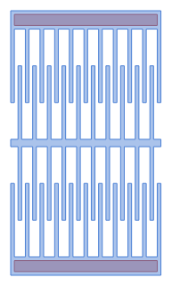

Differential comb pair: two anchored combs facing each other across one moving spine (the shuttle). Moving along +y engages the upper comb and disengages the lower one by the same amount, so their capacitance difference follows the motion linearly; as an actuator, each comb pulls one way. Point: shuttle, the middle of the shared moving spine. Ports: lower and upper, each comb's connection.

| Parameter | Default | Limits | |
|---|---|---|---|
| `fingers` | `10` | ≥ 1, whole | Moving fingers of each comb |
| `finger_width` | `2` | > 0 | Finger width (µm) |
| `finger_length` | `40` | > 0 | Finger length (µm) |
| `gap` | `2` | > 0 | Lateral finger gap (µm) |
| `overlap` | `20` | ≥ 0, < finger_length | Initial finger overlap of each comb (µm) |
| `moving_spine_width` | `4` | > 0 | Shuttle width (µm) |

| Port | At | Direction | Width | |
|---|---|---|---|---|
| `lower` | `lower.port.drive` | *as at* | *as at* | The lower comb's connection |
| `upper` | `upper.port.drive` | *as at* | *as at* | The upper comb's connection |

*Tags: electrode, comb drive, differential, sense, capacitive*

### `mems.parallel_plate`

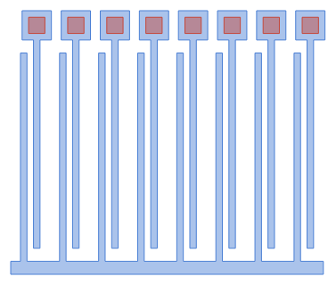

Gap-closing (parallel-plate) electrodes: moving fingers up from a moving spine, each with a fixed finger `gap` to its right and `far_gap` to its left, so that moving along +x closes the small gaps and opens the large ones. Each fixed finger hangs from its own anchor above. The capacitance is about n ε₀ t L / gap (n moving fingers, t the thickness, L the length); beyond a third of the gap the electrostatic pull wins (pull-in). Point: moving, the middle of the moving spine's bottom edge, where it attaches. Port: fixed, above the fixed electrodes' anchors, which a bus joins.

| Parameter | Default | Limits | |
|---|---|---|---|
| `fingers` | `8` | ≥ 1, whole | Moving fingers |
| `finger_width` | `2` | > 0 | Finger width (µm) |
| `length` | `60` | > 0 | Overlap of moving and fixed fingers, L (µm) |
| `gap` | `2` | > 0 | The gap that closes (µm) |
| `far_gap` | `6` | ≥ gap | The gap on the other side, that opens (µm) |
| `spine_width` | `4` | > 0 | Moving spine width (µm) |
| `clearance` | `4` | > 0 | Between the moving fingers' tips and the fixed anchors, and between the fixed fingers and the moving spine (µm) |
| `anchor_size` | `9` | > 4, ≤ pitch - 2 | Fixed fingers' anchor pads (µm); neighbours stay 2 µm apart |
| `pitch` | `2 * finger_width + gap + far_gap` |  | *(derived)* From one moving finger to the next (µm) |
| `x_start` | `-fingers * pitch / 2` |  | *(derived)* |

| Port | At | Direction | Width | |
|---|---|---|---|---|
| `fixed` | `fixed_anchors.top` | `up` | `anchor_size` | The fixed electrodes: their anchors, joined above (or on a level below) |

*Tags: electrode, parallel plate, gap closing, capacitive, sense, accelerometer*

## Devices

Whole devices made of the parts, as examples to place, copy and change.

### `mems.lateral_resonator`

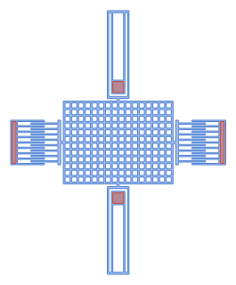

Lateral comb-drive resonator: a perforated proof mass hung on two folded flexures (above and below), driven and sensed by comb drives on its left and right, everything joined by short stems so that it all releases. It moves along x; its resonant frequency is about √(k / m) / 2π with k twice one flexure's `stiffness` and m the mass. As it is, it passes every check of `mems.surface`; for a process with a larger undercut or minimum width, widen the anchors and fingers to its rules. Ports: drive and sense, the combs' connections.

| Parameter | Default | Limits | |
|---|---|---|---|
| `columns` | `16` | ≥ 8, whole | Holes across the mass |
| `rows` | `12` | ≥ 4, whole | Holes up the mass |
| `flexure_length` | `100` | ≥ 20 | Inner beam length of the flexures (µm) |
| `fingers` | `8` | ≥ 1, whole | Moving fingers of each comb |
| `stem` | `4` | ≥ 2 | Gap bridged by the stems that join the parts to the mass (µm) |
| `width` | `columns * 10 + 2.5` |  | *(derived)* Mass width (µm) |
| `height` | `rows * 10 + 2.5` |  | *(derived)* Mass height (µm) |

| Port | At | Direction | Width | |
|---|---|---|---|---|
| `drive` | `left_comb.port.drive` | *as at* | *as at* | The driving comb's connection |
| `sense` | `right_comb.port.drive` | *as at* | *as at* | The sensing comb's connection |

*Tags: device, resonator, comb drive, folded flexure, example*

### `mems.accelerometer`

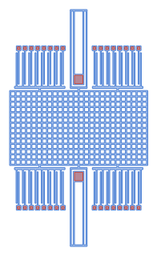

Single-axis lateral accelerometer: a perforated proof mass on two folded flexures (above and below), sensing x with four banks of gap-closing electrodes, two above and two below the mass. The right-hand banks are mirrored, so moving along +x closes their large gaps where the left-hand ones close their small ones: left minus right is a differential signal. Its sensitivity is m / k (displacement per acceleration), k twice one flexure's `stiffness`. As it is, it passes every check of `mems.surface`; for a process with a larger undercut or minimum width, widen the anchors and fingers to its rules. Ports: one per bank's fixed electrodes (upper_left, …); the left ones together against the right ones.

| Parameter | Default | Limits | |
|---|---|---|---|
| `columns` | `26` | ≥ 20, whole | Holes across the mass |
| `rows` | `14` | ≥ 4, whole | Holes up the mass |
| `flexure_length` | `120` | ≥ 20 | Inner beam length of the flexures (µm) |
| `fingers` | `8` | ≥ 1, whole | Moving fingers of each electrode bank |
| `bank_offset` | `74` | ≥ 50 | From the mass's centre line to the middle of each bank (µm) |
| `stem` | `4` | ≥ 2 | Gap bridged by the stems that join the parts to the mass (µm) |
| `width` | `columns * 10 + 2.5` |  | *(derived)* Mass width (µm) |
| `height` | `rows * 10 + 2.5` |  | *(derived)* Mass height (µm) |

| Port | At | Direction | Width | |
|---|---|---|---|---|
| `upper_left` | `upper_left_bank.port.fixed` | *as at* | *as at* | Fixed electrodes of the upper left bank |
| `upper_right` | `upper_right_bank.port.fixed` | *as at* | *as at* | Fixed electrodes of the upper right bank |
| `lower_left` | `lower_left_bank.port.fixed` | *as at* | *as at* | Fixed electrodes of the lower left bank |
| `lower_right` | `lower_right_bank.port.fixed` | *as at* | *as at* | Fixed electrodes of the lower right bank |

*Tags: device, accelerometer, inertial, parallel plate, folded flexure, example*
