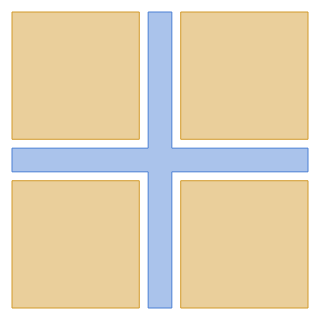
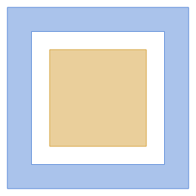
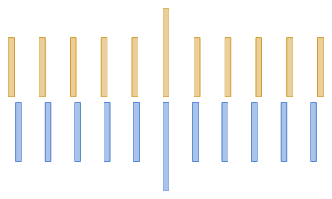
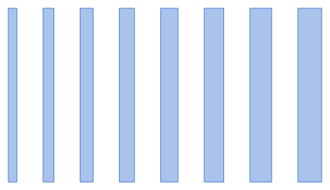
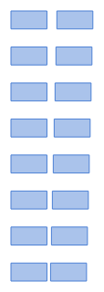
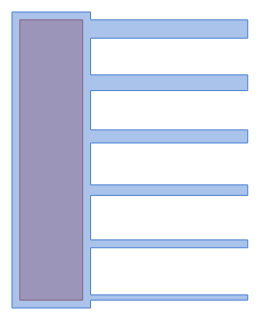
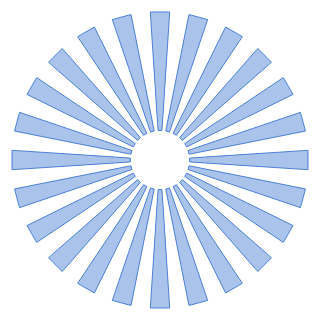
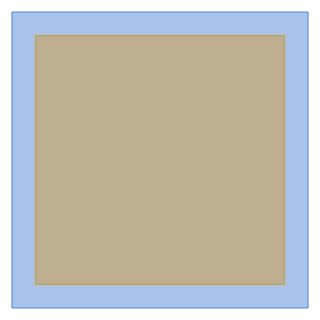
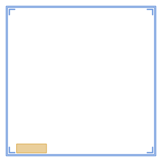

# The `std` library

Generic layout parts for any process: alignment marks, test structures, pads, die frame. Every project has it: its components are placed as
`std.<component>`, read-only (**Copy into the project** makes an editable
copy). Each is shown at its defaults.

*This page is generated from the components by `python docs/gallery.py`.*

## Alignment

Marks that align one layer to another, and scales that read the misalignment.

### `std.cross_mark`

Cross alignment mark: a cross on the component's level and, on the level above, its counterpart, four squares in the cross's corners that leave `gap` around it. Aligned, the gap is the same on every side. Its center is where the arms cross.

| Parameter | Default | Limits | |
|---|---|---|---|
| `arm` | `50` | > width / 2 + gap | Arm length from the centre (µm) |
| `width` | `8` | > 0 | Arm width (µm) |
| `gap` | `3` | > 0 | Clearance between the cross and its counterpart: the alignment tolerance (µm) |

*Tags: alignment, mark, cross, overlay*

### `std.box_in_box`

Box-in-box alignment mark: a square frame on the component's level and a box on the level above, centred in it with `gap` all round. Measured overlay is the difference between opposite gaps.

| Parameter | Default | Limits | |
|---|---|---|---|
| `outer` | `60` | > 2 * frame + 2 * gap | Outer edge of the frame (µm) |
| `frame` | `8` | > 0 | Frame width (µm) |
| `gap` | `6` | > 0 | Gap between the frame and the box (µm) |
| `inner` | `outer - 2 * frame - 2 * gap` |  | *(derived)* Edge of the box (µm) |

*Tags: alignment, mark, overlay, box*

### `std.vernier`

Vernier scale reading misalignment along x: a main scale on the component's level (lines `pitch` apart, below) and a vernier on the level above (lines `pitch + step` apart, above), each with a longer centre line. The vernier line that lines up with a main-scale line, counted from the centre, times `step` is the offset; it reads up to ± lines × step. Turn it 90° to read y. Its center is between the two centre lines.

| Parameter | Default | Limits | |
|---|---|---|---|
| `lines` | `5` | ≥ 1, whole | Lines on each side of the centre line |
| `pitch` | `10` | > line_width | Main-scale pitch (µm) |
| `step` | `0.5` | > 0 | Resolution: how much longer the vernier pitch is (µm) |
| `line_width` | `2` | > 0 | Line width (µm) |
| `length` | `20` | > 0 | Line length (µm) |
| `gap` | `2` | ≥ 0 | Between the two scales (µm) |
| `vernier_pitch` | `pitch + step` |  | *(derived)* Vernier pitch (µm) |

*Tags: alignment, vernier, overlay, metrology*

## Test structures

Structures that show what the process resolves and releases.

### `std.line_ladder`

Line-width ladder: lines of growing width, the first `start` wide and each next one `step` wider, `space` apart, from the origin along +x. The narrowest line that survives is the smallest resolved width.

| Parameter | Default | Limits | |
|---|---|---|---|
| `count` | `8` | ≥ 2, whole | Number of lines |
| `start` | `2` | > 0 | Width of the first line (µm) |
| `step` | `0.5` | ≥ 0 | Width added from one line to the next (µm) |
| `length` | `40` | > 0 | Line length (µm) |
| `space` | `6` | > 0 | Space between neighbouring lines (µm) |

*Tags: test structure, resolution, line width, metrology*

### `std.gap_ladder`

Gap ladder: pairs of blocks, the gap between them `start` in the first row and `step` wider in each next one, rows stacked along +y from the origin (the gaps are at x = 0 to the gap's width). The narrowest gap that opens is the smallest resolved space.

| Parameter | Default | Limits | |
|---|---|---|---|
| `count` | `8` | ≥ 2, whole | Number of rows |
| `start` | `2` | > 0 | Gap in the first row (µm) |
| `step` | `0.5` | ≥ 0 | Gap added from one row to the next (µm) |
| `block` | `20` | > 0 | Width of each block (µm) |
| `height` | `10` | > 0 | Height of each block (µm) |
| `space` | `10` | > 0 | Between rows (µm) |

*Tags: test structure, resolution, gap, space, metrology*

### `std.release_test`

Etch and release test: cantilevers of growing width from an anchored pad, the first `start` wide and each next one `step` wider. Those narrow enough for the undercut come free; the rest stay stuck, which is what the release rule warns about. The pad's anchor is on the level's anchor layer (`level.anchor`), so the level needs one. Point: root, the middle of the pad's right edge, where the cantilevers start.

| Parameter | Default | Limits | |
|---|---|---|---|
| `count` | `6` | ≥ 2, whole | Number of cantilevers |
| `start` | `2` | > 0 | Width of the first cantilever (µm) |
| `step` | `1` | ≥ 0 | Width added from one cantilever to the next (µm) |
| `length` | `60` | > 0 | Cantilever length (µm) |
| `pitch` | `20` | > start + (count - 1) * step | From one cantilever to the next (µm) |
| `pad` | `30` | > 2 * enclosure | Pad width (µm) |
| `enclosure` | `3` | ≥ 0 | Pad overlap around the anchor (µm) |
| `span` | `(count - 1) * pitch + start + (count - 1) * step` |  | *(derived)* Height of the cantilevers' row (µm) |

*Tags: test structure, release, undercut, etch, cantilever*

### `std.resolution_star`

Resolution star (Siemens star): wedges and gaps of equal angle around the centre, from `inner` to `radius`. Features shrink towards the centre; the radius where wedges merge or vanish gives the resolution, about 2π r / (2 spokes) there. At the inner radius they are π inner / spokes wide.

| Parameter | Default | Limits | |
|---|---|---|---|
| `spokes` | `24` | ≥ 3, whole | Number of wedges |
| `radius` | `100` | > inner | Outer radius (µm) |
| `inner` | `20` | > 0 | Inner radius, where the wedges stop (µm) |
| `half` | `90 / spokes` |  | *(derived)* Half a wedge's angle (°) |

*Tags: test structure, resolution, star, siemens star, metrology*

## Pads

Bond and probe pads.

### `std.bond_pad`

Square bond or probe pad on the component's level, with an opening on the level above (passivation, or metal on the pad) inset by `margin`; set `opening` to 0 for a pad without one.

| Parameter | Default | Limits | |
|---|---|---|---|
| `size` | `100` | > 2 * margin | Pad edge length (µm) |
| `margin` | `8` | ≥ 0 | Pad around the opening (µm) |
| `opening` | `1` | ≥ 0, ≤ 1, whole | 1: an opening on the level above; 0: none |

*Tags: pad, bond pad, probe, wire bond, contact*

## Frame

The die's outline, scribe lane and marks.

### `std.die_frame`

Die frame centred on the origin: the die's share of the scribe lane as a ring at its edge, L-shaped marks in its four inner corners, and a label area on the level above near the bottom left corner (for the die's name; text will come as a shape of its own). Point: label, the middle of the label area.

| Parameter | Default | Limits | |
|---|---|---|---|
| `width` | `5000` | > 2 * lane + 2 * mark | Die width, x (µm) |
| `height` | `5000` | > 2 * lane + 2 * mark | Die height, y (µm) |
| `lane` | `50` | > 0 | The die's share of the scribe lane: half the lane (µm) |
| `mark` | `200` | > mark_width | Length of each arm of a corner mark (µm) |
| `mark_width` | `20` | > 0 | Width of the corner marks (µm) |
| `inset` | `50` | ≥ 0 | From the lane to the corner marks and the label area (µm) |
| `label_width` | `1000` | > 0 | Label area width (µm) |
| `label_height` | `300` | > 0 | Label area height (µm) |
| `inside_x` | `width/2 - lane - inset` |  | *(derived)* Inner corner, x (µm) |
| `inside_y` | `height/2 - lane - inset` |  | *(derived)* Inner corner, y (µm) |

*Tags: frame, die, scribe lane, dicing, chip, label*
