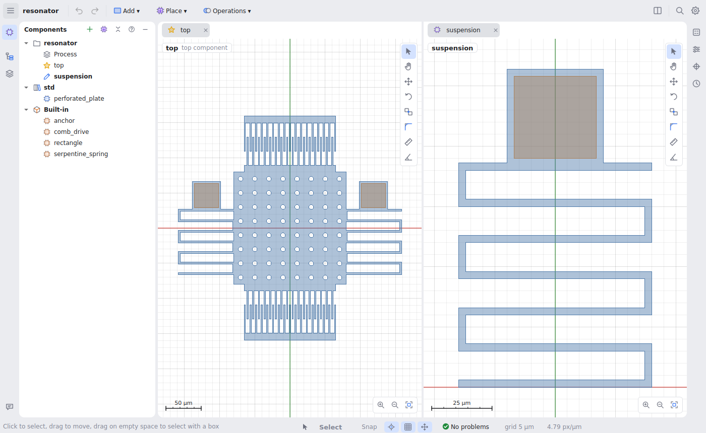
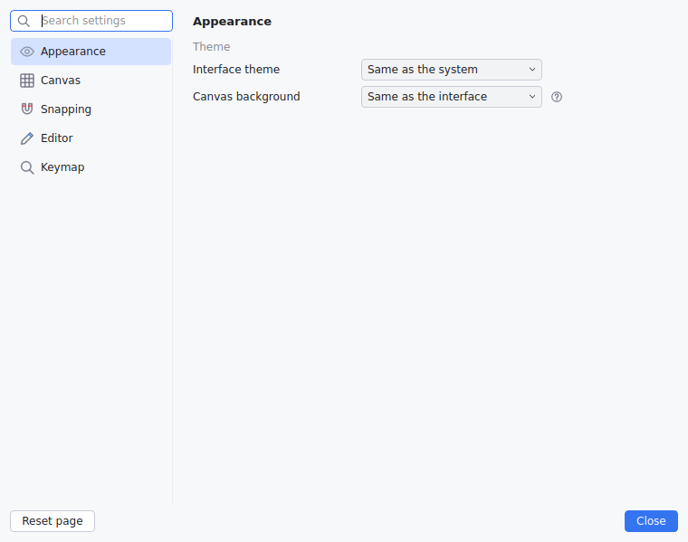

# The window

The window follows JetBrains IDEs for the editor parts (one toolbar row, tool
windows opened from the edges, tabs, settings, Find Action) and
Blender/Unity for the geometry (canvas modes, gizmos, a red x axis and a green
y axis).


## Toolbar

One row: **☰** (every menu is in it; menu paths in this guide such as
**View → Dark canvas** are inside it), the project's name, undo and redo,
then:

- **Add ▾**: primitives. Rectangle, circle, polygon and path start their
  drawing tool; an arc is added as a default one.
- **Place ▾**: components to put into the one you are editing.
- **Operations ▾**: subtract, intersect, XOR, offset, fillet, layer map,
  transform, make component.

On the right: split view, **Find Action** (Ctrl+Shift+A: type part of a
command's name, Enter runs it; Shift twice searches components, shapes and
parameters too) and settings.

**Right-click on the canvas** offers what fits where you clicked. On empty
space (which clears the selection) it is adding there: **Add**, **Place
component**, **Paste**, **Select all** (Ctrl+A) and **Fit**. On a shape it
is what can be done to the selection: the operations, **Rotate & mirror**,
**Zoom to selection** (Shift+F), **Rename…** (F2, for one shape: its name in
Properties, ready to type over) and cut, copy, paste, duplicate, delete.

In every menu a command's shortcut is in a lighter colour at the right, and
an option that can be switched on or off (**View → Dark canvas**) has a check
box.

Names from somewhere else are written with where they are from, as you type
them: `std.perforated_plate` (a library's component), `base.top` (a shape's
point), `device.anchor` (a level's layer). The part before the dot is in a
lighter colour so the name stands out, in menus such as **Place**, in the
process list and in the layer stack's levels.

The toolbar is also the window's title bar: minimize, maximize and close are
at its right end. Drag an empty part of it to move the window, double-click it
to maximize or restore, and drag the window's edges or corners to resize it.
**Settings → Appearance → Use the toolbar as the title bar** switched off
brings the system's title bar back.

## Tool windows

Panels open and close from the stripes on the window's edges:

| Where | Windows |
|---|---|
| Left stripe, top | **Components** |
| Left stripe, below | **Shapes**, **Layers** |
| Left stripe, bottom | **Messages** (runs along the bottom) |
| Right stripe | **Properties**, **Parameters**, **Points**, **History** |

Each place shows one window at a time; the left side splits when Components
and Shapes (or Layers) are both open. Every panel has a **?** in its header:
hover it for what the panel is for. The same **?** explains things in place
elsewhere (alignment, points, the process, each setting). Which windows are
open, and their sizes, are remembered. **View → Panels** lists them too. Drag
a panel's edge past the narrowest it can be and it closes; it opens again at
the size it had.

## Tabs and split view

Every component opens in its own tab, with its own zoom, selection and view;
the panels show the current tab. Double-click a component in **Components**,
or a placed component on the canvas or in **Shapes**, to open it.

**View → Split view** (Ctrl+\\) shows two tabs side by side: edit the spring
on one side and watch the resonator that uses it on the other.



- A `*` on a tab marks a component changed since the last save; a star marks
  the top component, a lock a read-only one.
- Right-click a tab to close it, the others or all, or to open it in the
  other pane.
- Library and built-in components open **read-only** and show their
  interface, as a library does in code: the geometry, the description, the
  public parameters and the points. How they are built stays hidden
  (**View → Show implementation of read-only components** shows it).

## Status bar

The current hint, the active tool and its options (the drawing layer and path
width while drawing, the angle step for Rotate), the snapping toggles (shape
points, grid) and the gizmo toggle, then problems (click to open Messages),
grid step, zoom and cursor position.

## Notes and motion

What a command did shows as a note at the bottom of the editor: "Exported
resonator.gds" (with **Show in folder**), "Aligned A to B", "Undid Move". A
note goes by itself after a few seconds; pointing at it keeps it. An error
stays until you close it, with **Show messages** to see it in Messages. The
status bar keeps the hint for the tool you are using.

The canvas glides to a place rather than jumping: **Fit** (F), the zoom
buttons, and a problem chosen in Messages. Scrolling or panning takes over at
once. A shape you pick in the Shapes panel, in Search Everywhere or in History
glows on the canvas for a moment, and comes into view if it was outside.
Clicking a shape on the canvas selects it without the glow: you are already
looking at it.

While you drag or draw, the live value is next to the cursor as well as in
the status bar: a move's offset (and the point it snaps to), the angle of a
rotation, a rectangle's or circle's size, the length and angle of the polygon
or path edge you are drawing, a corner's radius. Pointing at a shape for a
moment says what it is: its name, kind and layer, or the component it places.
Over the selection the cursor shows that a drag moves it.

Scroll bars float over a panel's edge instead of taking a strip of it. A bar
shows while the content moves or the pointer is in the panel, widens when you
point at it, and fades out a moment later; while it is gone, clicks go to what
is under it.

**Settings → Appearance → Reduce motion** turns the animations off: the view
jumps, notes and scroll bars appear and go at once, and picked shapes do not
glow.

## Settings

**☰ → File → Settings…** (Ctrl+Alt+S): appearance (light, dark, as the
system or [your own theme](#your-own-theme); the canvas can keep its own
background), canvas (fill opacity,
outlines, grid, overlays, gizmo size, zoom step), snapping, editor defaults
and the keymap: every command with a shortcut, its keys and the menu it is in.
The search field filters them, shortcuts too; changes apply at once and are
kept per user.



### Your own theme

A theme is a JSON file of colours. Put it in your themes folder (*Settings →
Appearance* shows where, with a button that opens it), named after the theme:
`ocean.json` is the theme `ocean`. It can start from another theme and change
only some colours:

```json
{
  "name": "Ocean",
  "parent": "dark",
  "ui": {"accent": "#1abc9c", "selected": "#1d4d47"},
  "canvas": {"background": "#0f1c24", "highlight": "#ffb347"},
  "icons": {"blue": "#1abc9c"}
}
```

- `ui` colours the window, `canvas` the layout canvas and `icons` the icons.
  `metrics` sets sizes in pixels: corner radii, header and row heights, the
  spacing scale and font sizes (for example `"metrics": {"row_height": 30}` for
  roomier tables). Radii and font sizes change at once; spacing and heights on
  the next start.
  The built-in [light](../../src/mems_sketch/gui/themes/light.json) and
  [dark](../../src/mems_sketch/gui/themes/dark.json) themes list every colour.
- Without a `parent`, a theme must give every colour.
- `dark` (`true` or `false`) says whether it is a dark theme; it is taken from
  the parent when left out. **View → Dark canvas** goes by it.
- Colours are `#rrggbb`, or `#aarrggbb` with transparency.
- The error, warning, info and done signs are drawn in `icons` `red`, `amber`,
  `blue` and `green`. `amber` is a yellow dark enough to read on the window's
  background; left out, the sign uses `yellow`.

The theme appears in *Interface theme* and *Canvas background* the next time
Settings opens. A theme that cannot be used (a misspelt colour name, a size
out of range, a parent that does not exist) is listed under the folder, with
the reason. A theme changes colours and sizes, never what is where.

## Undo and editor state

- **Undo/redo** is one history for the whole project and goes back to the tab
  where the change was made, reopening it if it was closed.
- Every edit is checked: if it would stop the project from building
  (including components that use the edited one), it is taken back with a
  message.
- **How you were looking at the project** comes back when you reopen it: open
  tabs and the split, zoom and position per tab, selections, rulers,
  collapsed tree items, hidden layers, trial values, the drawing layer. It is
  kept in `.mems-sketch/` in the project folder, which is never committed to
  git; delete it to reset the views.
